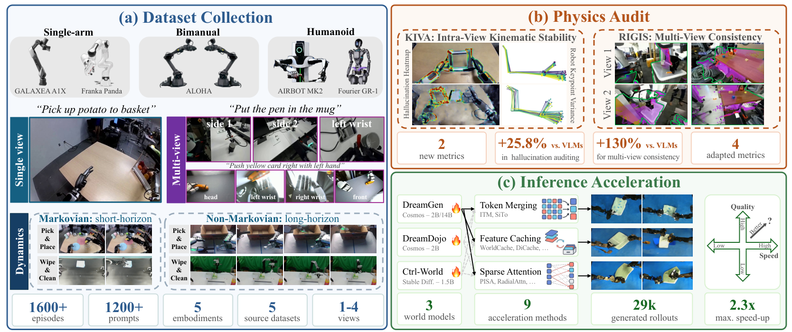
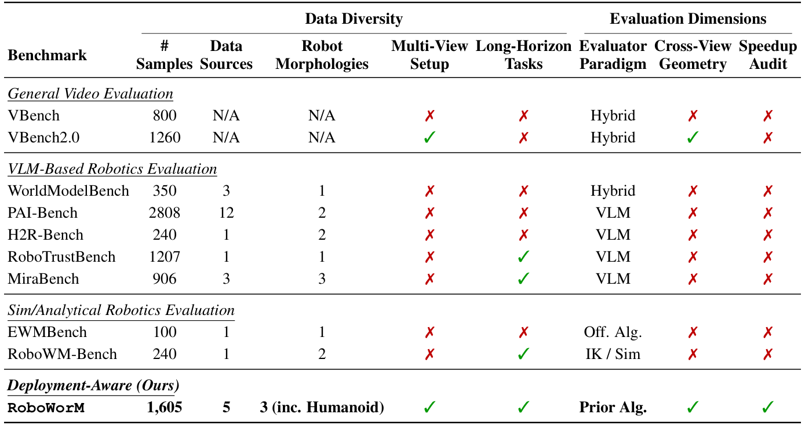
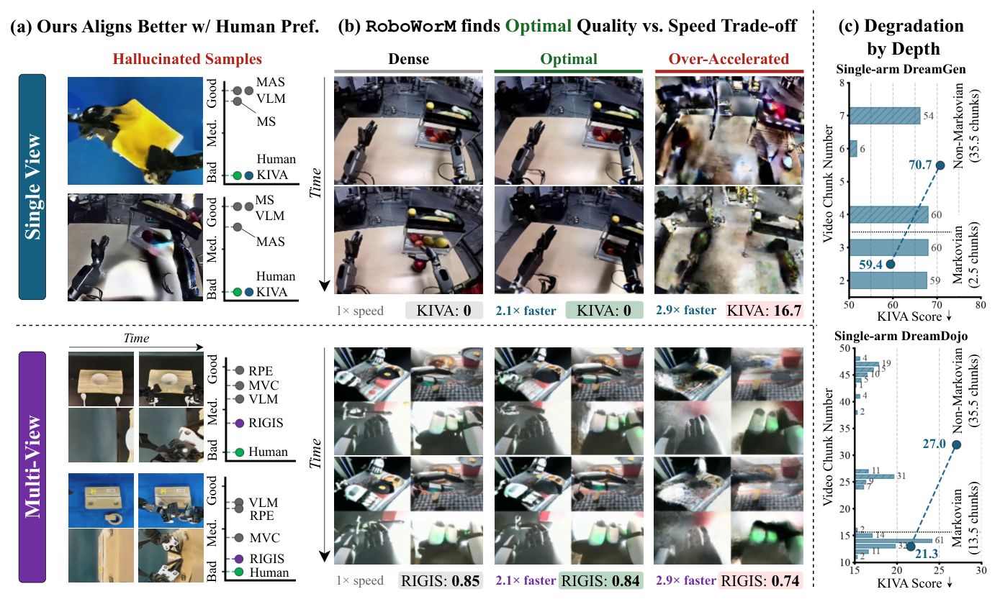
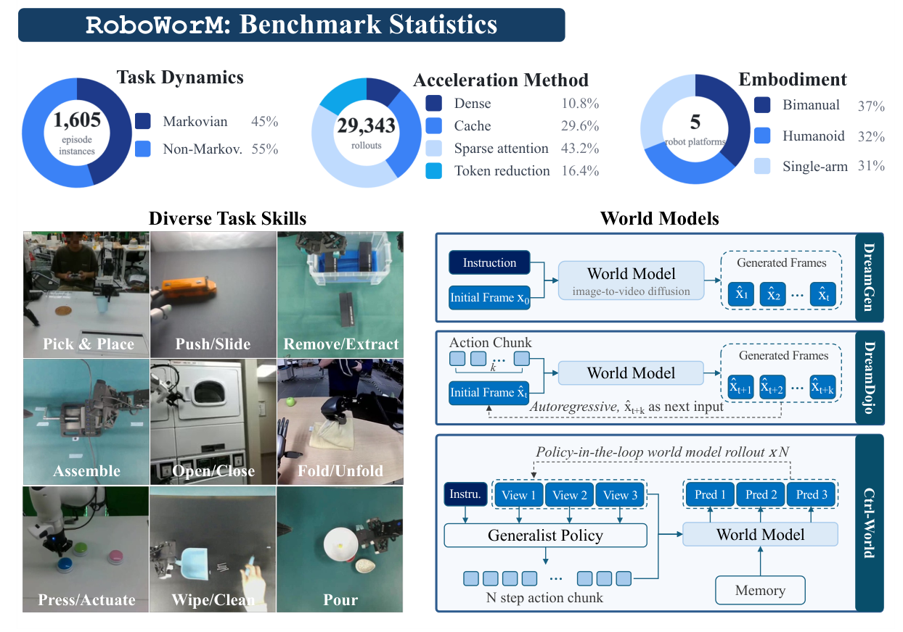
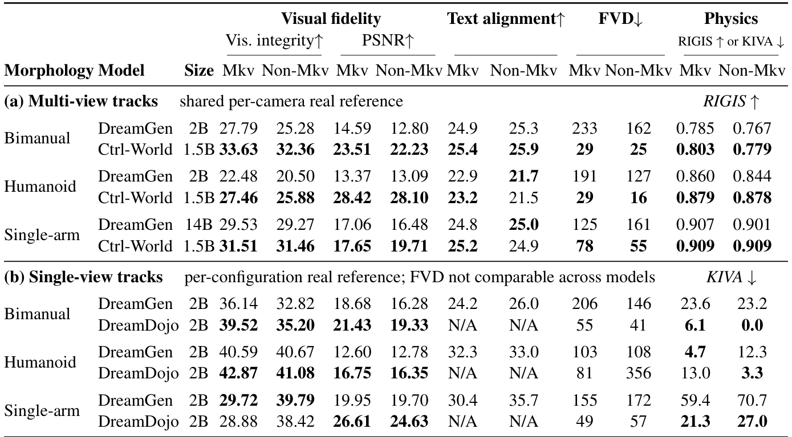
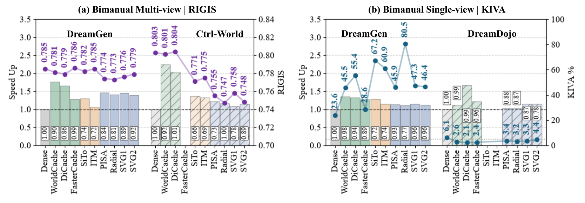
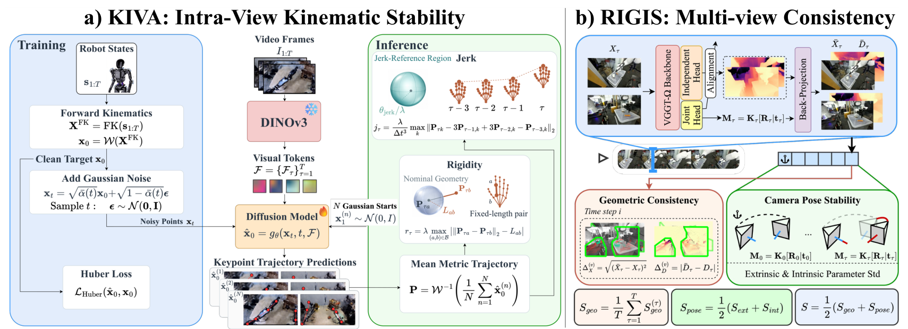

<div align="center">


# RoboWorM: Evaluating Movement Realism, Consistency and Acceleration Effects in Embodied Video World Models

<!-- Paper badge hidden until the arXiv version is public:
<a href="https://roboworm.github.io/roboworm/"></a>
-->
<a href="https://roboworm.github.io/roboworm/"></a>
<a href="https://huggingface.co/datasets/doanh25032004/vgp_datasets"></a>
<a href="https://huggingface.co/datasets/doanh25032004/video_gen_physics"></a>
<a href="#citation"></a>

<a href="https://roboworm.github.io/roboworm/#teaser"></a>

</div>

Code, data pointers and run scripts for **RoboWorM**, a physics audit for robot video
world models and the training-free methods that accelerate them. Interactive figures,
tables and rollout videos are on the **[project page](https://roboworm.github.io/roboworm/)**.

[](https://roboworm.github.io/roboworm/#abstract)

*Benchmark overview: (a) episodes collected from 5 corpora, 3 embodiments, 1–4 views and
two task horizons; (b) the physics audit with KIVA and RIGIS; (c) inference acceleration
across 3 world models and 9 methods, about 29k rollouts.*

RoboWorM tests action-/text-conditioned video world models on real robot episodes. It
also tests whether training-free acceleration keeps the physics of the rollout intact.

- **Data**: 1,605 real episodes from **5 source corpora**: DROID, RoboChallenge,
  AIST Bimanual, RoboCOIN and GR00T Teleop GR1. They cover **3 embodiments**
  (single-arm, bimanual, humanoid), **1–4 synchronized views** and two task regimes,
  **Markovian** and **non-Markovian**. On disk these are named `makovian` / `non_makovian`.
- **World models (3)**: **DreamGen** (Cosmos-Predict2 2B / 14B DiT), **DreamDojo**
  (2B action-conditioned DiT) and **Ctrl-World** (Stable Video Diffusion 1.5B U-Net).
  Together they make 12 dense cells (listed in
  [checkpoints/CHECKPOINTS.md](checkpoints/CHECKPOINTS.md)), plus 3-view Ctrl-World variants.
- **Acceleration (9 + dense)**:
  - feature caching: FasterCache, DiCache, WorldCache
  - sparse attention: SVG1, SVG2, Radial, PISA
  - token reduction: SiTo, ITM
- **Metrics**:
  - **KIVA**: intra-view kinematic stability (embodiment hallucination), reported as
    excess over the real-video anchor.
  - **RIGIS**: inter-view geometry and intrinsic/extrinsic stability (VGGT-Omega).
  - **Visual Integrity**: CLIP-IQA+, p10 over frames.
  - **Text Alignment**: CLIPScore.
  - **FVD**: I3D, 16-frame windows at 5 fps, shared real pool.
  - **PSNR / SSIM / LPIPS** against the paired dense rollout.
- **Speedup**: the model's internal per-segment timer, divided by the timer of the
  paired dense run (same episodes, same GPU).

Rollout totals: 3,166 dense rollouts, and 29,343 including the accelerators
([docs/datasets/cell_matrix.md](docs/datasets/cell_matrix.md)).

[](https://roboworm.github.io/roboworm/#related)

*How RoboWorM compares with existing video world model benchmarks on data diversity
(samples, sources, morphologies, multi-view, long-horizon tasks) and evaluation dimensions
(evaluator paradigm, cross-view geometry, speedup audit).*

[](https://roboworm.github.io/roboworm/#fig6)

*What the audit catches. (a) Hallucinated rollouts that VLM judges rate as good, while
KIVA (single-view) and RIGIS (multi-view) agree with human raters that they are bad.
(b) Dense vs. a well-tuned accelerator (2.1× faster, same score) vs. an over-accelerated
one (2.9× faster, kinematics and geometry break). (c) KIVA degradation grows with rollout
depth, from Markovian to non-Markovian tasks.*

See the [project page](https://roboworm.github.io/roboworm/#fig6) for the rollout videos behind these examples.

## Repository layout

```
datasets/            source / training data (LeRobot) + prepared DreamGen corpora   -> HF vgp_datasets
sampling_dataset/    benchmark rollouts {method}/{embodiment}/{input,output}/...    -> HF video_gen_physics
checkpoints/         base/ (released weights), finetuned/ (ours), metrics/ (I3D, VGGT-Omega, ...)
models/              dreamgen/ (Cosmos-Predict2), DreamDojo/, Ctrl-World/  (each with its own .venv)
methods/             cache_strategy/{WorldCache,DiCache,FasterCache}, sparse_attention/{pisa,radial,svg},
                     prunning/{SiTo,importance_token_merge}
finetuning/          dreamgen/, dreamdojo/, ctrlworld/ training launchers + data prep
scripts/             prepare/ infer/ run/{dreamgen,dreamdojo,ctrlworld}/ train/ metrics/ tables/ tools/
metrics/             evaluate.py (CLI), kiva/, rigis/, fvd.py, clip_score.py, fidelity.py, quality/
assets/              scripts/ (figure/table producers) + generated assets
results/             metric outputs and report tables (not shipped; created on first run)
docs/                setup, datasets, training, inference, acceleration, metrics, extending, assets/figures
```

Docs index: [docs/README.md](docs/README.md). Script tree: [scripts/README.md](scripts/README.md).

## 1. Environments

There are six isolated environments, all built with [uv](https://docs.astral.sh/uv/)
except KIVA's conda env. Never mix them; the launchers activate the right one
themselves. The versions below were read from the cluster venvs. Exact install commands
(CUDA wheel indexes, kernels that build with `--no-build-isolation`), notes and a
verification snippet are in [docs/setup/README.md](docs/setup/README.md). `uv pip
freeze` snapshots are in [docs/setup/env_freeze/](docs/setup/env_freeze/).

| env | python | torch / CUDA | key extras | used for | build |
|---|---|---|---|---|---|
| `models/dreamgen/.venv` | 3.12 | 2.6.0 / cu124 | flash-attn 2.8.3, flashinfer 0.2.5, transformer-engine 2.14, piq, pyiqa, torchmetrics | DreamGen inference + training, every method except SVG2; `python -m metrics.evaluate` (fidelity, FVD, Visual Integrity, Text Alignment) | `env_freeze/dreamgen.txt` |
| `models/dreamgen/.venv_svg` | 3.12 | 2.6.0 / cu124 | as above, but **flashinfer 0.3.1** | DreamGen **SVG2** only | `env_freeze/dreamgen__svg.txt` |
| `models/DreamDojo/.venv` | 3.10 | 2.7.0 / cu128 | flash-attn 2.7.3, natten 0.21, transformer-engine 2.2, flashinfer 0.3.1 | DreamDojo inference + training, all methods | `uv sync --extra=cu128` in `models/DreamDojo` |
| `models/Ctrl-World/.venv` | 3.10 | 2.7.1 / cu126 | diffusers 0.34, flashinfer 0.3.1 | Ctrl-World inference + training, all methods | `models/Ctrl-World/requirements.txt` + `env_freeze/Ctrl-World.txt` |
| `metrics/rigis/.venv` | 3.13 | 2.14.1 / cu126 | VGGT-Omega, numba (added by `run.sh`) | RIGIS | `cd metrics/rigis && uv sync` |
| `hdmi` conda env (`HAL_PYTHON`) | 3.10 | 2.7.0 / cu128 | transformers 5.2 (DINOv3), pytorch-kinematics | KIVA | `pip install -e "metrics/kiva[dino,video,bench]"` |

```bash
# example: the main DreamGen env (the other five are in docs/setup/README.md)
uv venv --python 3.12 models/dreamgen/.venv && PY=models/dreamgen/.venv
uv pip install --python $PY torch==2.6.0 torchvision==0.21.0 --index-url https://download.pytorch.org/whl/cu124
uv pip install --python $PY --no-build-isolation flash-attn==2.8.3 "transformer-engine[pytorch]==2.14.1"
uv pip install --python $PY --index-strategy unsafe-best-match --extra-index-url https://download.pytorch.org/whl/cu124 \
    --extra-index-url https://flashinfer.ai/whl/cu124/torch2.6/ --extra-index-url https://pypi.nvidia.com \
    -r docs/setup/env_freeze/dreamgen.txt
$PY/bin/python -c "import torch, flash_attn, flashinfer; print(torch.__version__, torch.cuda.is_available(), flashinfer.__version__)"
```

You also need **ffmpeg / ffprobe** on `PATH` (prepare scripts, GT rendering, RIGIS
frame extraction, KIVA probing), and `export HF_HUB_DISABLE_XET=1` for every Hugging
Face download on a parallel filesystem.

## 2. Data

[](https://roboworm.github.io/roboworm/#benchmark)

*Benchmark composition: 1,605 episodes split between Markovian and non-Markovian tasks,
29,343 rollouts across dense and the three acceleration families, 5 robot platforms over
3 embodiments, a range of manipulation skills, and the three world models with their
conditioning (DreamGen: instruction + first frame; DreamDojo: autoregressive action
chunks; Ctrl-World: multi-view, policy-in-the-loop with memory).*

```bash
pip install -U "huggingface_hub[cli]"
export HF_HUB_DISABLE_XET=1     # required on this cluster's parallel filesystem
```

**Source / training data**: <https://huggingface.co/datasets/doanh25032004/vgp_datasets>
(36.4 GB, LeRobot format), downloaded to `datasets/`:

```bash
# LeRobot sources + the DreamGen training corpora
hf download doanh25032004/vgp_datasets --repo-type dataset --local-dir datasets \
    --include "single_arm/*" "bimanual/*" "humanoid/*" \
              "single_arm_static_dreamgen_16fps/*" "bimanual_dreamgen_16fps/*" "humanoid_dreamgen_16fps/*" \
              "bimanual_multiview_grid_seg16_dreamgen/*" "humanoid_multiview_grid_seg16_dreamgen/*"
# one embodiment/view only
hf download doanh25032004/vgp_datasets --repo-type dataset --local-dir datasets --include "humanoid/singleview/*"
```

**Benchmark rollouts**: <https://huggingface.co/datasets/doanh25032004/video_gen_physics>
(178 GB, about 136k files), downloaded to `sampling_dataset/`. Paths follow the pattern
`sampling_dataset/{method}/{embodiment}/{input,output}/{view}/{model}/{split}/...`, and
`input/` exists only under `dense/`.

```bash
hf download doanh25032004/video_gen_physics --repo-type dataset --local-dir sampling_dataset            # all
hf download doanh25032004/video_gen_physics --repo-type dataset --local-dir sampling_dataset \
    --include "dense/*" "pisa/*"                                                                        # two methods
hf download doanh25032004/video_gen_physics --repo-type dataset --local-dir sampling_dataset \
    --include "*/bimanual/input/multiview/dreamgen/*" "*/bimanual/output/multiview/dreamgen/*"          # one cell
hf download doanh25032004/video_gen_physics --repo-type dataset --local-dir sampling_dataset \
    --include "data_for_web/*.json" "data_for_web/*.csv"                                                # human labels
```

Details:
- [docs/datasets/README.md](docs/datasets/README.md): corpora, layout, Markovian
  labelling, and which variants are used.
- [docs/datasets/sampling_dataset.md](docs/datasets/sampling_dataset.md): layout,
  output conventions per model, and input builders per cell.

### Where to put the downloads

Every launcher, prepare script and metric runner resolves paths relative to the repo
root, so run all downloads from the repo root with exactly these `--local-dir` targets.
The three trees are gitignored; only `checkpoints/CHECKPOINTS.md` is tracked.

| download | HF repo (type) | `--local-dir` | read by |
|---|---|---|---|
| source / training data | `doanh25032004/vgp_datasets` (dataset) | `datasets` | `scripts/run/*` (`--dataset-base datasets/<emb>/<view>`), `scripts/prepare/`, `finetuning/` |
| benchmark rollouts | `doanh25032004/video_gen_physics` (dataset) | `sampling_dataset` | `metrics.evaluate`, `scripts/metrics/`, `assets/scripts/`; launchers write new rollouts here |
| base weights | `doanh25032004/vgp_checkpoints_{nvidia,dreamdojo,google_t5}` (model) | `checkpoints/base/{nvidia,dreamdojo,google-t5}` | all model launchers |
| other base + metric weights | `doanh25032004/vgp_checkpoints_own` (model) | `checkpoints`, then re-layout | Ctrl-World, FVD I3D, WorldScore probes (KIVA / RIGIS weights: see CHECKPOINTS.md, Metrics) |
| our fine-tuned weights | `doanh25032004/vgp_exp_logs` (model) | `exp_logs`, then re-layout | every fine-tuned cell (`checkpoints/finetuned/...`) |

The re-layout snippet for the last two rows is in
[checkpoints/CHECKPOINTS.md](checkpoints/CHECKPOINTS.md#restore-from-huggingface). After it,
the repo root looks like this:

```
datasets/
  single_arm/{singleview,multiview}/{makovian,non_makovian}/        LeRobot: meta/ data/ videos/
  bimanual/{singleview,multiview}/{makovian,non_makovian}/<task>/    one dir per task
  humanoid/singleview/{makovian,non_makovian}/                       + captions/
  humanoid/multiview/{makovian,non_makovian}/<task>/                 RoboCOIN tasks
  single_arm_static_dreamgen_16fps/  bimanual_dreamgen_16fps/  humanoid_dreamgen_16fps/
  bimanual_multiview_grid_seg16_dreamgen/  humanoid_multiview_grid_seg16_dreamgen/
                                                                     DreamGen training corpora: videos/ metas/ t5_xxl/
sampling_dataset/
  {method}/{embodiment}/{input,output}/{view}/{model}/{split}/...    input/ only under dense/
  data_for_web/                                                      human labels + catalog
checkpoints/
  base/{nvidia,dreamdojo,google-t5,ctrl_world,stabilityai,openai,pi05_droid,meta-llama,droid,mjcf,...}
  finetuned/{ctrlworld,dreamdojo,dreamgen}/
  metrics/{fvd,worldscore,vggt_omega,kiva}/
```

`hf download` is the current name of `huggingface-cli download`; both take the same
arguments. Keep `export HF_HUB_DISABLE_XET=1` set for every download (the Xet backend
fails on parallel filesystems). Quick sanity check after downloading:

```bash
ls datasets/humanoid/singleview/makovian/meta            # info.json episodes.jsonl tasks.jsonl ...
ls datasets/bimanual/multiview/makovian | head -3          # close_cardboard_box close_toolbox ...
ls sampling_dataset/dense/humanoid/output/singleview/dreamgen   # makovian non_makovian
ls checkpoints/base checkpoints/finetuned checkpoints/metrics
```

Metric outputs and report tables are written to `results/` (gitignored, created on first run).

## 3. Checkpoints

[checkpoints/CHECKPOINTS.md](checkpoints/CHECKPOINTS.md) lists the checkpoint of every
dense cell (path, size, step) together with the base and metric weights. To restore from
the HF model repos `doanh25032004/vgp_checkpoints_{nvidia,dreamdojo,google_t5,own}`:

```bash
export HF_HUB_DISABLE_XET=1
hf download doanh25032004/vgp_checkpoints_nvidia    --repo-type model --local-dir checkpoints/base/nvidia
hf download doanh25032004/vgp_checkpoints_dreamdojo --repo-type model --local-dir checkpoints/base/dreamdojo
hf download doanh25032004/vgp_checkpoints_google_t5 --repo-type model --local-dir checkpoints/base/google-t5
hf download doanh25032004/vgp_checkpoints_own       --repo-type model --local-dir checkpoints   # then re-layout, see CHECKPOINTS.md
```

The full backup / restore recipe and its gotchas are in
[docs/setup/hf_backup_restore.md](docs/setup/hf_backup_restore.md).

## 4. Training (optional: fine-tuned checkpoints are released)

Three cells use released weights:
- Ctrl-World single-arm
- DreamGen 14B single-arm MV
- DreamDojo GR1

The other 11 checkpoints were post-trained. Each one was trained on exactly one prepared
input, built by the prepare script below from the LeRobot sources in `datasets/`:

| checkpoint (`checkpoints/finetuned/...`) | prepare script | training input |
|---|---|---|
| `ctrlworld/bimanual_multiview_5fps/checkpoint-280000.pt` (3-view) | `scripts/prepare/prepare_ctrlworld_bimanual_multiview.py` + `models/Ctrl-World/dataset_meta_info/create_meta_info_bimanual.py` | `models/Ctrl-World/dataset_example/bimanual_multiview_5fps/` |
| `ctrlworld/bimanual_multiview_4view_grid/checkpoint-110000.pt` | `scripts/prepare/prepare_ctrlworld_bimanual_multiview_grid.py` + meta builder | `models/Ctrl-World/dataset_example/bimanual_multiview_4view_grid/` |
| `ctrlworld/humanoid_multiview/checkpoint-200000.pt` (3-view) | `scripts/prepare/prepare_ctrlworld_humanoid_multiview.py` + meta builder | `models/Ctrl-World/dataset_example/humanoid_multiview/` |
| `ctrlworld/humanoid_multiview_4view_grid/checkpoint-140000.pt` | `scripts/prepare/prepare_ctrlworld_humanoid_multiview_grid.py` + meta builder | `models/Ctrl-World/dataset_example/humanoid_multiview_4view_grid/` |
| `dreamgen/.../multiview/bimanual_multiview_seg16/.../iter_000120000.pt` | `finetuning/dreamgen/scripts/prepare_bimanual_multiview_grid_dreamgen.py` → `segment_bimanual_multiview_grid_dreamgen.py` → T5 → `reencode_bimanual_multiview_seg_16fps.py` | `datasets/bimanual_multiview_grid_seg16_dreamgen/` |
| `dreamgen/.../multiview/humanoid_multiview_seg16/.../iter_000100000.pt` | `finetuning/dreamgen/scripts/prepare_humanoid_multiview_grid_dreamgen.py` → `segment_humanoid_multiview_grid_dreamgen.py` → T5 → `reencode_humanoid_multiview_seg_16fps.py` | `datasets/humanoid_multiview_grid_seg16_dreamgen/` |
| `dreamgen/.../singleview/single_arm_static_singleview_16fps_v2/.../iter_000090000.pt` | `finetuning/dreamgen/scripts/prepare_single_arm_robochallenge_dreamgen_16fps.py` + T5 | `datasets/single_arm_static_dreamgen_16fps/` |
| `dreamgen/.../singleview/bimanual_singleview_16fps/.../iter_000110000.pt` | `finetuning/dreamgen/scripts/prepare_bimanual_dreamgen_16fps.py` + T5 | `datasets/bimanual_dreamgen_16fps/` |
| `dreamgen/.../singleview/humanoid_singleview_16fps/.../iter_000090000.pt` | `scripts/tools/data/run_caption_humanoid_singleview.sh` → `finetuning/dreamgen/scripts/prepare_humanoid_dreamgen_16fps.py` + T5 | `datasets/humanoid_dreamgen_16fps/` |
| `dreamdojo/.../exp_single_arm_sv/single_arm_singleview/checkpoints/iter_000030000` | none (`MultiVideoActionDataset` reads LeRobot directly) | `datasets/single_arm/singleview/` |
| `dreamdojo/.../exp_aloha_resume70k/aloha_bimanual_singleview_full/checkpoints/iter_000100000` | none (`MultiVideoActionDataset`) | `datasets/bimanual/singleview/` |

The full table (launchers, configs, warm starts, the 3 released checkpoints) is in
[docs/training/README.md](docs/training/README.md). Representative commands:

```bash
# DreamGen 2B (models/dreamgen/.venv): prepare -> T5 -> launch, one script per checkpoint
NPROC=4 bash finetuning/dreamgen/train_bimanual_16fps.sh                     # bimanual SV
SKIP_REENCODE=1 NPROC=4 bash finetuning/dreamgen/train_bimanual_multiview_grid_16fps.sh   # bimanual MV 2x2
# DreamDojo 2B (models/DreamDojo/.venv)
NPROC=2 bash finetuning/dreamdojo/launch.sh dreamdojo_2b_480_640_single_arm_sv
# Ctrl-World (models/Ctrl-World/.venv): encode latents -> meta -> accelerate train
NPROC=4 bash scripts/train/run_humanoid_multiview_ctrlworld_train_4view_grid.sh
```

## 5. Dense and accelerated rollouts

Launchers live in `scripts/run/{dreamgen,dreamdojo,ctrlworld}/`. They are resumable,
discover episodes automatically, and write to `sampling_dataset/<method>/...`. Each
accelerated launcher is identical to the dense launcher of its cell except for the
method flags. The full table of 12 dense launchers and the method knobs is in
[docs/inference/README.md](docs/inference/README.md).
Per-method details and the full (cell × method) config matrix: [docs/acceleration/](docs/acceleration/README.md).

```bash
# DreamGen
CUDA_VISIBLE_DEVICES=0 bash scripts/run/dreamgen/run_humanoid_multiview_dreamgen_full.sh           # dense
CUDA_VISIBLE_DEVICES=0 bash scripts/run/dreamgen/run_humanoid_multiview_dreamgen_dicache.sh        # DiCache
CUDA_VISIBLE_DEVICES=0 bash scripts/run/dreamgen/run_humanoid_multiview_dreamgen_pisa.sh           # PISA
CUDA_VISIBLE_DEVICES=0 bash scripts/run/dreamgen/run_humanoid_multiview_dreamgen_svg2.sh           # SVG2 (.venv_svg)
CUDA_VISIBLE_DEVICES=0 bash scripts/run/dreamgen/run_single_arm_singleview_dreamgen_sito.sh        # SiTo

# DreamDojo
CUDA_VISIBLE_DEVICES=0 bash scripts/run/dreamdojo/run_humanoid_singleview_dreamdojo_full_episode.sh   # dense
CUDA_VISIBLE_DEVICES=0 bash scripts/run/dreamdojo/run_humanoid_singleview_dreamdojo_all_methods.sh    # all 9 methods

# Ctrl-World
CUDA_VISIBLE_DEVICES=0 bash scripts/run/ctrlworld/run_bimanual_multiview_ctrlworld_4view_grid.sh             # dense
CUDA_VISIBLE_DEVICES=0 bash scripts/run/ctrlworld/run_bimanual_multiview_ctrlworld_4view_grid_worldcache.sh  # WorldCache
CUDA_VISIBLE_DEVICES=0 bash scripts/run/ctrlworld/run_single_arm_multiview_ctrlworld_itm.sh                  # ITM
```

Launcher names follow the pattern
`scripts/run/<family>/run_<embodiment>_<view>_<model>[_4view_grid]_<method>.sh`.
For trial runs, send output to a scratch tree with `SAVE_ROOT` / `OUTPUT_ROOT`.

[](https://roboworm.github.io/roboworm/#models)

*Dense (non-accelerated) results for every cell, split into Markovian and non-Markovian
tasks: visual integrity, PSNR, text alignment, FVD and the physical audit (RIGIS for
multi-view tracks, KIVA for single-view tracks). Ctrl-World leads on multi-view, DreamDojo
on most single-view settings. Interactive tables:
[project page](https://roboworm.github.io/roboworm/#models).*

### Speedup measurement

Speedup is the dense time divided by the method time, measured with each model's
internal per-segment timer on the same episodes and GPU:
- DreamGen: `Total inference time`
- DreamDojo: `[Timing] Generated`
- Ctrl-World: `wall_time_s`

```bash
bash scripts/tools/tune/_bench_uniform_timing.sh --estimate
bash scripts/tools/tune/_bench_uniform_timing.sh --all --gpu 0          # or --cell dreamdojo_humanoid_sv
models/dreamgen/.venv/bin/python assets/scripts/merge_timing_shards.py    # -> results/reports/speedup_perchunk.csv
models/dreamgen/.venv/bin/python assets/scripts/make_timing_pass_table.py # -> results/reports/timing_pass.{json,csv}
models/dreamgen/.venv/bin/python scripts/tables/make_speedup_summary.py --sampling-root sampling_dataset --out-dir results/reports
```

[](https://roboworm.github.io/roboworm/#acceleration)

*Speed–quality trade-off of every method on the bimanual cells. Bars show the speedup over
the paired dense rollout, the right axis shows the physical audit (RIGIS for multi-view,
KIVA for single-view), and boxed values show aggregate quality retention. Caching gives
the largest speedups with near-zero degradation; token pruning degrades the most.*

Per-embodiment trade-off plots (humanoid, single-arm) are on the [project page](https://roboworm.github.io/roboworm/#acceleration).

## 6. Metrics

The CLI is `python -m metrics.evaluate`. The registry and options are documented in
[metrics/README.md](metrics/README.md), and the evaluation protocol in
[docs/metrics/README.md](docs/metrics/README.md).

[](https://roboworm.github.io/roboworm/#method)

*The two physical audits. (a) KIVA: a shared video-conditioned reader trained on
forward-kinematics targets; five denoised candidates are averaged before rigidity and jerk
are measured and calibrated against real-video references. (b) RIGIS: VGGT-Ω estimates
depth and cameras to score geometric consistency and camera-pose stability across views.*

[](https://roboworm.github.io/roboworm/#results)

*KIVA (top) and RIGIS (bottom) against four VLM judges, zero-shot and with
chain-of-thought: correlation and accuracy with human scores, and latency per video second.*

Interactive KIVA / RIGIS demos and the human-alignment analysis: [project page](https://roboworm.github.io/roboworm/#kiva).

```bash
PY=models/dreamgen/.venv/bin/python; export HF_HUB_OFFLINE=1
CELL=sampling_dataset/dense/single_arm/output/singleview/dreamgen/makovian
$PY -m metrics.evaluate --pred-root $CELL --metrics fidelity clip_score --out results/metrics/sa_sv_mk
$PY -m metrics.evaluate --pred-root $CELL --metrics fvd                 --out results/metrics/sa_sv_mk_fvd
$PY -m metrics.evaluate --pred-root $CELL --metrics kiva --opt kiva.embodiment=single_arm \
    --opt kiva.score_ref=true --out results/metrics/sa_sv_mk_kiva

# full-benchmark sweeps
ROLE=gt bash metrics/kiva/run.sh --tmux && bash metrics/kiva/run.sh --tmux          # KIVA   -> results/hallucination/
bash metrics/rigis/run.sh --tmux                                                    # RIGIS  -> results/multiview_consistency/
bash scripts/metrics/run_dense_nr.sh                                                # Visual Integrity + Text Alignment
MACHINES=1 bash scripts/metrics/run_dr_metrics.sh 0                                 # PSNR/SSIM/LPIPS/FVD vs dense
```

Two protocol rules matter when comparing numbers:
- Fidelity is always measured against the **dense prediction** of the same episode,
  never against GT.
- Multiview FVD uses a **shared per-camera real pool**.

## 7. Extending RoboWorM

The benchmark can be extended along three axes: a new world model, a new embodiment /
dataset, or a new fast-inference method. A new entrant is directly comparable to every
existing number, because metrics are stored per clip and paired only when results are
aggregated, so nothing already in the benchmark is re-scored.
Guides, grounded in the code: [docs/extending/](docs/extending/README.md).

[](docs/extending/README.md)

*The three extension paths. (A) A new world model: fine-tune on the released corpus, run
the benchmark grid, score with the existing metrics (a new row). (B) A new embodiment
dataset: register it, prepare prompts/actions/video, fine-tune the backbones, and add a
KIVA keypoint reader and a RIGIS camera setup (a new column). (C) A new acceleration
method: plug it into the existing models, run the grid, and measure its speed–quality
trade-off against dense.*

| add | what it takes | guide |
|---|---|---|
| a world model (a new row) | fine-tune on the released corpus; `prepare` → `infer` → `run` scripts writing `sampling_dataset/dense/...`; score with the existing metrics | [new_world_model.md](docs/extending/new_world_model.md) |
| an embodiment / dataset (a new column) | LeRobot corpus, regime + taxonomy labels, camera mounts; fine-tune each backbone; a KIVA keypoint reader with real-segment thresholds, a RIGIS view pair, an FVD real pool | [new_embodiment_dataset.md](docs/extending/new_embodiment_dataset.md) |
| an acceleration method | `add_<method>_args` + enable hook in `methods/<family>/`; one launcher per cell mirroring dense; per-cell knee; matched dense timing | [new_acceleration_method.md](docs/extending/new_acceleration_method.md) |
| a metric | a `BaseMetric` subclass registered in `metrics/registry.py`, run by `python -m metrics.evaluate` | [new_metric.md](docs/extending/new_metric.md) |

Setup of the two physical audits: [docs/metrics/kiva.md](docs/metrics/kiva.md),
[docs/metrics/rigis.md](docs/metrics/rigis.md).

## Citation

```bibtex
@inproceedings{roboworm2027,
  title     = {RoboWorM: Evaluating Movement Realism, Consistency and Acceleration Effects in Embodied Video World Models},
  author    = {Anonymous},
  booktitle = {International Conference on Learning Representations (ICLR)},
  year      = {2027},
  note      = {Under review},
  url       = {https://roboworm.github.io/roboworm/}
}
```

## Acknowledgements

RoboWorM builds on the code of many projects. Each project keeps its own license, and
its LICENSE file stays in the vendored directory. Paths, commits, our changes and the
license-file locations are listed in [docs/THIRD_PARTY.md](docs/THIRD_PARTY.md).
Dataset licenses follow the source corpora: DROID, RoboChallenge, AIST Bimanual,
RoboCOIN and GR00T Teleop GR1.

| role | project | license | in this repo |
|---|---|---|---|
| world model | [Cosmos-Predict2](https://github.com/nvidia-cosmos/cosmos-predict2) / [GR00T Dreams](https://github.com/NVIDIA/GR00T-Dreams) | Apache-2.0 | `models/dreamgen/` |
| world model | [DreamDojo](https://github.com/NVIDIA/DreamDojo) | Apache-2.0 | `models/DreamDojo/` |
| world model | [Ctrl-World](https://github.com/Robert-gyj/Ctrl-World) (+ [diffusers](https://github.com/huggingface/diffusers) SVD pipeline) | MIT (Apache-2.0) | `models/Ctrl-World/` |
| policy | [openpi](https://github.com/Physical-Intelligence/openpi) | Apache-2.0 | `models/Ctrl-World/openpi` (gitlink) |
| caching | [FasterCache](https://github.com/Vchitect/FasterCache) | none declared | `methods/cache_strategy/FasterCache/` |
| caching | [DiCache](https://github.com/Bujiazi/DiCache), [WorldCache](https://github.com/umair1221/WorldCache) | re-implemented | `methods/cache_strategy/{DiCache,WorldCache}/` |
| sparse attention | [Sparse VideoGen 1/2](https://github.com/svg-project/Sparse-VideoGen) (+ CUTLASS, FlashInfer, pybind11) | Apache-2.0 | `methods/sparse_attention/Sparse-VideoGen/` |
| sparse attention | [Radial Attention](https://github.com/mit-han-lab/radial-attention) | Apache-2.0 | `methods/sparse_attention/radial-attention/` |
| sparse attention | [PISA](https://github.com/xie-lab-ml/piecewise-sparse-attention) | MIT | `methods/sparse_attention/piecewise-sparse-attention/` |
| token reduction | [SiTo](https://github.com/EvelynZhang-epiclab/SiTo) (on [ToMeSD](https://github.com/dbolya/tomesd), MIT) | none declared | `methods/prunning/SiTo/` |
| token reduction | [Importance-Based Token Merging](https://github.com/cvlab-stonybrook/importance-token-merge) | MIT | `methods/prunning/importance-token-merge/` |
| RIGIS | [VGGT-Omega](https://github.com/facebookresearch/vggt-omega) | FAIR Noncommercial Research | `metrics/rigis/vggt_omega/` |
| KIVA | [DINOv3](https://github.com/facebookresearch/dinov3), [pytorch-kinematics](https://github.com/UM-ARM-Lab/pytorch_kinematics), [robot_descriptions](https://github.com/robot-descriptions/robot_descriptions.py) | DINOv3 License, MIT, Apache-2.0 | pip / HF weights |
| motion metrics | [WorldScore](https://github.com/haoyi-duan/WorldScore) with [SEA-RAFT](https://github.com/princeton-vl/SEA-RAFT), [VFIMamba](https://github.com/MCG-NJU/VFIMamba), [GroundingDINO](https://github.com/IDEA-Research/GroundingDINO), [SAM 2](https://github.com/facebookresearch/sam2) | MIT, BSD-3, Apache-2.0 | `metrics/WorldScore` (gitlink) |
| Visual Integrity | CLIP-IQA+ via [pyiqa](https://github.com/chaofengc/IQA-PyTorch) | PolyForm Noncommercial 1.0.0 | pip |
| Text Alignment | CLIPScore via [torchmetrics](https://github.com/Lightning-AI/torchmetrics) + [CLIP](https://github.com/openai/CLIP) | Apache-2.0, MIT | pip |
| fidelity, FVD | [piq](https://github.com/photosynthesis-team/piq) ([LPIPS](https://github.com/richzhang/PerceptualSimilarity)), [I3D](https://github.com/google-deepmind/kinetics-i3d) via [StyleGAN-V](https://github.com/universome/stylegan-v) export | Apache-2.0, BSD-2 | pip / `checkpoints/metrics/fvd/` |

Motion Amplitude (RBench) and FVD are re-implemented from their papers.
