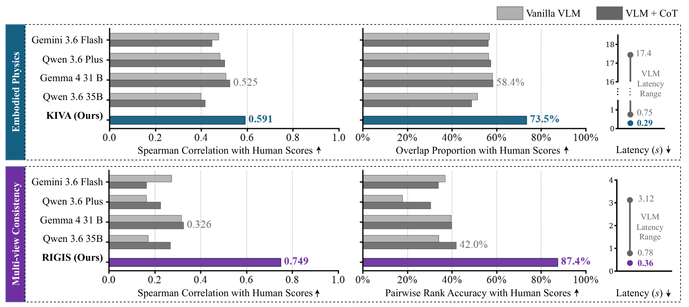

# RoboWorM: Evaluating Movement Realism, Consistency and Acceleration Effects in Embodied Video World Models

Code, data pointers and reproduction scripts for **RoboWorM** (ICLR 2027 submission;
PDF: [docs/paper/RoboWM_ICLR2027_check.pdf](docs/paper/RoboWM_ICLR2027_check.pdf)).

**Project page: <https://roboworm.github.io/roboworm/>** ·
Data: [vgp_datasets](https://huggingface.co/datasets/doanh25032004/vgp_datasets) ·
Rollouts: [video_gen_physics](https://huggingface.co/datasets/doanh25032004/video_gen_physics) ·
[BibTeX](#citation)


*Figure 1. Overview of RoboWorM. (a) Dataset collection over 5 corpora, 3 embodiments,
1–4 views and two task horizons. (b) Physics audit with KIVA and RIGIS. (c) Inference
acceleration: 3 world models, 9 acceleration methods, 29k rollouts.*

RoboWorM tests action-/text-conditioned video world models on real robot episodes. It
also tests whether training-free acceleration keeps the physics of the rollout intact.

- **Data**: 1,605 real episodes from **5 source corpora**: DROID, RoboChallenge,
  AIST Bimanual, RoboCOIN and GR00T Teleop GR1. They cover **3 embodiments**
  (single-arm, bimanual, humanoid), **1–4 synchronized views** and two task regimes,
  **Markovian** and **non-Markovian**. On disk these are named `makovian` / `non_makovian`.
- **World models (3)**: **DreamGen** (Cosmos-Predict2 2B / 14B DiT), **DreamDojo**
  (2B action-conditioned DiT) and **Ctrl-World** (Stable Video Diffusion 1.5B U-Net).
  Together they make 12 dense cells (Table C1), plus 3-view Ctrl-World variants.
- **Acceleration (9 + dense)**:
  - feature caching: FasterCache, DiCache, WorldCache
  - sparse attention: SVG1, SVG2, Radial, PISA
  - token reduction: SiTo, ITM
- **Metrics**:
  - **KIVA**: intra-view kinematic stability (embodiment hallucination), reported as
    excess over the real-video anchor.
  - **RIGIS**: inter-view geometry and intrinsic/extrinsic stability (VGGT-Omega).
  - **Visual Integrity**: CLIP-IQA+, p10 over frames.
  - **Text Alignment**: CLIPScore.
  - **FVD**: I3D, 16-frame windows at 5 fps, shared real pool.
  - **PSNR / SSIM / LPIPS** against the paired dense rollout.
- **Speedup**: the model's internal per-segment timer, divided by the timer of the
  paired dense run (same episodes, same GPU).

Rollout totals: 3,166 dense rollouts, and 29,343 including the accelerators
([docs/datasets/cell_matrix.md](docs/datasets/cell_matrix.md)).


*Figure 3. (a) KIVA: a shared video-conditioned reader learns from forward-kinematics
targets; five denoised candidates are averaged before rigidity and jerk are measured and
calibrated against real-video references. (b) RIGIS: VGGT-Ω estimates depth and cameras
for geometric consistency and camera-pose stability.*



*Figure 4. KIVA (top) and RIGIS (bottom) against four VLM judges, zero-shot and with
chain-of-thought: correlation and accuracy with human scores, and latency per video second.*

Figures are copied from the paper / [project page](https://roboworm.github.io/roboworm/)
into [docs/assets/figures/](docs/assets/figures/).

## Repository layout

```
datasets/            source / training data (LeRobot) + prepared DreamGen corpora   -> HF vgp_datasets
sampling_dataset/    benchmark rollouts {method}/{embodiment}/{input,output}/...    -> HF video_gen_physics
checkpoints/         base/ (released weights), finetuned/ (ours), metrics/ (I3D, VGGT-Omega, ...)
models/              dreamgen/ (Cosmos-Predict2), DreamDojo/, Ctrl-World/  (each with its own .venv)
methods/             cache_strategy/{WorldCache,DiCache,FasterCache}, sparse_attention/{pisa,radial,svg},
                     prunning/{SiTo,importance_token_merge}
finetuning/          dreamgen/, dreamdojo/, ctrlworld/ training launchers + data prep
scripts/             prepare/ infer/ run/{dreamgen,dreamdojo,ctrlworld}/ train/ metrics/ tables/ tools/
metrics/             evaluate.py (CLI), kiva/, rigis/, fvd.py, clip_score.py, fidelity.py, quality/
assets/              scripts/ (paper figure/table producers), paper/ (LaTeX sources + generated assets)
results/             metric outputs read by the paper tables (see results/README.md)
docs/                setup, datasets, training, inference, acceleration, metrics, reproduce, paper, assets/figures
```

Docs index: [docs/README.md](docs/README.md). Script tree: [scripts/README.md](scripts/README.md).

## 1. Environments

There are six isolated environments, and launchers activate the right one themselves.
Frozen package lists are in [docs/setup/env_freeze/](docs/setup/env_freeze/). Full
instructions: [docs/setup/README.md](docs/setup/README.md).

| env | python | used for | freeze |
|---|---|---|---|
| `models/dreamgen/.venv` | 3.12 | DreamGen inference/training, all methods except SVG2; FVD / CLIPScore / fidelity | `dreamgen.txt` |
| `models/dreamgen/.venv_svg` | 3.12 | DreamGen SVG2 (FlashInfer 0.3.1) | `dreamgen__svg.txt` |
| `models/DreamDojo/.venv` | 3.10 | DreamDojo inference/training, all methods | `DreamDojo.txt` |
| `models/Ctrl-World/.venv` | 3.10 | Ctrl-World inference/training, all methods | `Ctrl-World.txt` |
| `metrics/rigis/.venv` | 3.13 (uv) | RIGIS | `metrics/rigis/uv.lock` |
| `hdmi` conda env (`HAL_PYTHON`) | 3.10 | KIVA | — |

```bash
python3.12 -m venv models/dreamgen/.venv
models/dreamgen/.venv/bin/pip install torch==2.6.0 torchvision --index-url https://download.pytorch.org/whl/cu124
models/dreamgen/.venv/bin/pip install -r docs/setup/env_freeze/dreamgen.txt
python3.12 -m venv models/dreamgen/.venv_svg && models/dreamgen/.venv_svg/bin/pip install -r docs/setup/env_freeze/dreamgen__svg.txt
python3.10 -m venv models/DreamDojo/.venv   && models/DreamDojo/.venv/bin/pip install -r docs/setup/env_freeze/DreamDojo.txt
python3.10 -m venv models/Ctrl-World/.venv  && models/Ctrl-World/.venv/bin/pip install -r docs/setup/env_freeze/Ctrl-World.txt
(cd metrics/rigis && uv sync)
conda create -n hdmi python=3.10 -y && conda run -n hdmi pip install -e metrics/kiva
export HAL_PYTHON="$(conda run -n hdmi which python)"
```

For the matching torch / CUDA wheel of each env, see [docs/setup/README.md](docs/setup/README.md).

## 2. Data

```bash
pip install -U "huggingface_hub[cli]"
export HF_HUB_DISABLE_XET=1     # required on this cluster's parallel filesystem
```

**Source / training data**: <https://huggingface.co/datasets/doanh25032004/vgp_datasets>
(36.4 GB, LeRobot format), downloaded to `datasets/`:

```bash
# only what the paper uses: LeRobot sources + the DreamGen training corpora
hf download doanh25032004/vgp_datasets --repo-type dataset --local-dir datasets \
    --include "single_arm/*" "bimanual/*" "humanoid/*" \
              "single_arm_static_dreamgen_16fps/*" "bimanual_dreamgen_16fps/*" "humanoid_dreamgen_16fps/*" \
              "bimanual_multiview_grid_seg16_dreamgen/*" "humanoid_multiview_grid_seg16_dreamgen/*"
# one embodiment/view only
hf download doanh25032004/vgp_datasets --repo-type dataset --local-dir datasets --include "humanoid/singleview/*"
```

**Benchmark rollouts**: <https://huggingface.co/datasets/doanh25032004/video_gen_physics>
(178 GB, about 136k files), downloaded to `sampling_dataset/`. Paths follow the pattern
`sampling_dataset/{method}/{embodiment}/{input,output}/{view}/{model}/{split}/...`, and
`input/` exists only under `dense/`.

```bash
hf download doanh25032004/video_gen_physics --repo-type dataset --local-dir sampling_dataset            # all
hf download doanh25032004/video_gen_physics --repo-type dataset --local-dir sampling_dataset \
    --include "dense/*" "pisa/*"                                                                        # two methods
hf download doanh25032004/video_gen_physics --repo-type dataset --local-dir sampling_dataset \
    --include "*/bimanual/input/multiview/dreamgen/*" "*/bimanual/output/multiview/dreamgen/*"          # one cell
hf download doanh25032004/video_gen_physics --repo-type dataset --local-dir sampling_dataset \
    --include "data_for_web/*.json" "data_for_web/*.csv"                                                # human labels
```

Details:
- [docs/datasets/README.md](docs/datasets/README.md): corpora, layout, Markovian
  labelling, and which variants are used.
- [docs/datasets/sampling_dataset.md](docs/datasets/sampling_dataset.md): layout,
  output conventions per model, and input builders per cell.

## 3. Checkpoints

[checkpoints/CHECKPOINTS.md](checkpoints/CHECKPOINTS.md) lists every checkpoint of
Table C1 (path, size, step) together with the base and metric weights. To restore from
the HF model repos `doanh25032004/vgp_checkpoints_{nvidia,dreamdojo,google_t5,own}`:

```bash
export HF_HUB_DISABLE_XET=1
hf download doanh25032004/vgp_checkpoints_nvidia    --repo-type model --local-dir checkpoints/base/nvidia
hf download doanh25032004/vgp_checkpoints_dreamdojo --repo-type model --local-dir checkpoints/base/dreamdojo
hf download doanh25032004/vgp_checkpoints_google_t5 --repo-type model --local-dir checkpoints/base/google-t5
hf download doanh25032004/vgp_checkpoints_own       --repo-type model --local-dir checkpoints   # then re-layout, see CHECKPOINTS.md
```

The full backup / restore recipe and its gotchas are in
[docs/setup/hf_backup_restore.md](docs/setup/hf_backup_restore.md).

## 4. Training (optional: fine-tuned checkpoints are released)

Three cells use released weights:
- Ctrl-World single-arm
- DreamGen 14B single-arm MV
- DreamDojo GR1

The other 11 checkpoints were post-trained. Each one was trained on exactly one prepared
input, built by the prepare script below from the LeRobot sources in `datasets/`:

| checkpoint (`checkpoints/finetuned/...`) | prepare script | training input |
|---|---|---|
| `ctrlworld/bimanual_multiview_5fps/checkpoint-280000.pt` (3-view) | `scripts/prepare/prepare_ctrlworld_bimanual_multiview.py` + `models/Ctrl-World/dataset_meta_info/create_meta_info_bimanual.py` | `models/Ctrl-World/dataset_example/bimanual_multiview_5fps/` |
| `ctrlworld/bimanual_multiview_4view_grid/checkpoint-110000.pt` | `scripts/prepare/prepare_ctrlworld_bimanual_multiview_grid.py` + meta builder | `models/Ctrl-World/dataset_example/bimanual_multiview_4view_grid/` |
| `ctrlworld/humanoid_multiview/checkpoint-200000.pt` (3-view) | `scripts/prepare/prepare_ctrlworld_humanoid_multiview.py` + meta builder | `models/Ctrl-World/dataset_example/humanoid_multiview/` |
| `ctrlworld/humanoid_multiview_4view_grid/checkpoint-140000.pt` | `scripts/prepare/prepare_ctrlworld_humanoid_multiview_grid.py` + meta builder | `models/Ctrl-World/dataset_example/humanoid_multiview_4view_grid/` |
| `dreamgen/.../multiview/bimanual_multiview_seg16/.../iter_000120000.pt` | `finetuning/dreamgen/scripts/prepare_bimanual_multiview_grid_dreamgen.py` → `segment_bimanual_multiview_grid_dreamgen.py` → T5 → `reencode_bimanual_multiview_seg_16fps.py` | `datasets/bimanual_multiview_grid_seg16_dreamgen/` |
| `dreamgen/.../multiview/humanoid_multiview_seg16/.../iter_000100000.pt` | `finetuning/dreamgen/scripts/prepare_humanoid_multiview_grid_dreamgen.py` → `segment_humanoid_multiview_grid_dreamgen.py` → T5 → `reencode_humanoid_multiview_seg_16fps.py` | `datasets/humanoid_multiview_grid_seg16_dreamgen/` |
| `dreamgen/.../singleview/single_arm_static_singleview_16fps_v2/.../iter_000090000.pt` | `finetuning/dreamgen/scripts/prepare_single_arm_robochallenge_dreamgen_16fps.py` + T5 | `datasets/single_arm_static_dreamgen_16fps/` |
| `dreamgen/.../singleview/bimanual_singleview_16fps/.../iter_000110000.pt` | `finetuning/dreamgen/scripts/prepare_bimanual_dreamgen_16fps.py` + T5 | `datasets/bimanual_dreamgen_16fps/` |
| `dreamgen/.../singleview/humanoid_singleview_16fps/.../iter_000090000.pt` | `scripts/tools/data/run_caption_humanoid_singleview.sh` → `finetuning/dreamgen/scripts/prepare_humanoid_dreamgen_16fps.py` + T5 | `datasets/humanoid_dreamgen_16fps/` |
| `dreamdojo/.../exp_single_arm_sv/single_arm_singleview/checkpoints/iter_000030000` | none (`MultiVideoActionDataset` reads LeRobot directly) | `datasets/single_arm/singleview/` |
| `dreamdojo/.../exp_aloha_resume70k/aloha_bimanual_singleview_full/checkpoints/iter_000100000` | none (`MultiVideoActionDataset`) | `datasets/bimanual/singleview/` |

The full table (launchers, configs, warm starts, the 3 released checkpoints) is in
[docs/training/README.md](docs/training/README.md). Representative commands:

```bash
# DreamGen 2B (models/dreamgen/.venv): prepare -> T5 -> launch, one script per checkpoint
NPROC=4 bash finetuning/dreamgen/train_bimanual_16fps.sh                     # bimanual SV
SKIP_REENCODE=1 NPROC=4 bash finetuning/dreamgen/train_bimanual_multiview_grid_16fps.sh   # bimanual MV 2x2
# DreamDojo 2B (models/DreamDojo/.venv)
NPROC=2 bash finetuning/dreamdojo/launch.sh dreamdojo_2b_480_640_single_arm_sv
# Ctrl-World (models/Ctrl-World/.venv): encode latents -> meta -> accelerate train
NPROC=4 bash scripts/train/run_humanoid_multiview_ctrlworld_train_4view_grid.sh
```

## 5. Dense and accelerated rollouts

Launchers live in `scripts/run/{dreamgen,dreamdojo,ctrlworld}/`. They are resumable,
discover episodes automatically, and write to `sampling_dataset/<method>/...`. Each
accelerated launcher is identical to the dense launcher of its cell except for the
method flags. The full table of 12 dense launchers and the method knobs is in
[docs/inference/README.md](docs/inference/README.md).
Per-method details and the full (cell × method) config matrix: [docs/acceleration/](docs/acceleration/README.md).

```bash
# DreamGen
CUDA_VISIBLE_DEVICES=0 bash scripts/run/dreamgen/run_humanoid_multiview_dreamgen_full.sh           # dense
CUDA_VISIBLE_DEVICES=0 bash scripts/run/dreamgen/run_humanoid_multiview_dreamgen_dicache.sh        # DiCache
CUDA_VISIBLE_DEVICES=0 bash scripts/run/dreamgen/run_humanoid_multiview_dreamgen_pisa.sh           # PISA
CUDA_VISIBLE_DEVICES=0 bash scripts/run/dreamgen/run_humanoid_multiview_dreamgen_svg2.sh           # SVG2 (.venv_svg)
CUDA_VISIBLE_DEVICES=0 bash scripts/run/dreamgen/run_single_arm_singleview_dreamgen_sito.sh        # SiTo

# DreamDojo
CUDA_VISIBLE_DEVICES=0 bash scripts/run/dreamdojo/run_humanoid_singleview_dreamdojo_full_episode.sh   # dense
CUDA_VISIBLE_DEVICES=0 bash scripts/run/dreamdojo/run_humanoid_singleview_dreamdojo_all_methods.sh    # all 9 methods

# Ctrl-World
CUDA_VISIBLE_DEVICES=0 bash scripts/run/ctrlworld/run_bimanual_multiview_ctrlworld_4view_grid.sh             # dense
CUDA_VISIBLE_DEVICES=0 bash scripts/run/ctrlworld/run_bimanual_multiview_ctrlworld_4view_grid_worldcache.sh  # WorldCache
CUDA_VISIBLE_DEVICES=0 bash scripts/run/ctrlworld/run_single_arm_multiview_ctrlworld_itm.sh                  # ITM
```

Launcher names follow the pattern
`scripts/run/<family>/run_<embodiment>_<view>_<model>[_4view_grid]_<method>.sh`.
For trial runs, send output to a scratch tree with `SAVE_ROOT` / `OUTPUT_ROOT`.

### Speedup measurement

Speedup is the dense time divided by the method time, measured with each model's
internal per-segment timer on the same episodes and GPU:
- DreamGen: `Total inference time`
- DreamDojo: `[Timing] Generated`
- Ctrl-World: `wall_time_s`

```bash
bash scripts/tools/tune/_bench_uniform_timing.sh --estimate
bash scripts/tools/tune/_bench_uniform_timing.sh --all --gpu 0          # or --cell dreamdojo_humanoid_sv
models/dreamgen/.venv/bin/python assets/scripts/merge_timing_shards.py  # -> results/reports/timing_pass.{json,csv}
models/dreamgen/.venv/bin/python scripts/tables/make_speedup_summary.py --sampling-root sampling_dataset --out-dir results/reports
```

## 6. Metrics

The CLI is `python -m metrics.evaluate`. The registry and options are documented in
[metrics/README.md](metrics/README.md), and the paper protocol in
[docs/metrics/README.md](docs/metrics/README.md).

```bash
PY=models/dreamgen/.venv/bin/python; export HF_HUB_OFFLINE=1
CELL=sampling_dataset/dense/single_arm/output/singleview/dreamgen/makovian
$PY -m metrics.evaluate --pred-root $CELL --metrics fidelity clip_score --out results/metrics/sa_sv_mk
$PY -m metrics.evaluate --pred-root $CELL --metrics fvd                 --out results/metrics/sa_sv_mk_fvd
$PY -m metrics.evaluate --pred-root $CELL --metrics kiva --opt kiva.embodiment=single_arm \
    --opt kiva.score_ref=true --out results/metrics/sa_sv_mk_kiva

# full-benchmark sweeps that feed the paper tables
ROLE=gt bash metrics/kiva/run.sh --tmux && bash metrics/kiva/run.sh --tmux          # KIVA   -> results/hallucination/
bash metrics/rigis/run.sh --tmux                                                    # RIGIS  -> results/multiview_consistency/
bash scripts/metrics/run_dense_nr.sh                                                # Visual Integrity + Text Alignment
MACHINES=1 bash scripts/metrics/run_dr_metrics.sh 0                                 # PSNR/SSIM/LPIPS/FVD vs dense
```

Two protocol rules matter for the tables:
- Fidelity is always measured against the **dense prediction** of the same episode,
  never against GT.
- Multiview FVD uses a **shared per-camera real pool**.

## 7. Reproducing tables and figures

Producers are in `assets/scripts/` and `scripts/tables/`. They write data to
`results/reports/` and LaTeX/PDF files to `assets/paper/{tables,figures,appendix/tables}/`.
The full mapping from paper item to producer to output, with the run order, is in
[docs/reproduce/README.md](docs/reproduce/README.md). Main entry points:

| paper item | producer |
|---|---|
| Table 2 (dense results per cell) | FVD pools (`assets/scripts/{fvd_camera_match,extract_perview_fvd_feats,pool_perview_fvd,pool_singleview_fvd,verify_shared_pool_fairness}.py`), then `export_dense_table_shared_pool.py`, then `make_rq1_dense_table.py` |
| Fig. 4 (KIVA / RIGIS vs human & VLM judges) | `scripts/tables/compare_ours_vs_vlm_correlation.py`, `analyze_geometry_label_correlation.py`, then `assets/scripts/make_rq3_human_alignment.py` |
| Fig. 5, C2–C3 (speedup vs physics) | timing pass, then `assets/scripts/dump_speedup_figure_data.py`, then `make_speedup_audit_figure.py`; stats in `rq2_tradeoff_stats.py` |
| Fig. 6c (rollout depth) | `assets/scripts/measure_rollout_depth.py`, then `make_singlearm_depth_figure.py` and `make_depth_vs_regime_figure.py` |
| App. A tables | `assets/scripts/make_benchmark_stats.py`, then `make_dataset_appendix_tables.py` and `make_cell_matrix.py` |
| App. C tables (C1, C3, accel configs, timing) | `make_finetune_config_table.py`, `make_impl_config_tables.py`, `make_timing_pass_table.py`, `scripts/tables/make_dense_generation_table.py` |

Script names keep the RQ numbering of an earlier draft (`make_rq1_*` = Table 2,
`make_rq3_*` = human alignment).

## 8. Extending RoboWorM

The benchmark is meant to be extended under the protocol of paper App. E. A new entrant
is directly comparable to every existing number, because metrics are stored per clip and
paired only when the tables are built, so nothing already in the benchmark is re-scored.
Guides, grounded in the code: [docs/extending/](docs/extending/README.md).

| add | what it takes | guide |
|---|---|---|
| a world model (a new row) | fine-tune on the released corpus; `prepare` → `infer` → `run` scripts writing `sampling_dataset/dense/...`; score with the existing metrics | [new_world_model.md](docs/extending/new_world_model.md) |
| an embodiment / dataset (a new column) | LeRobot corpus, regime + taxonomy labels, camera mounts; fine-tune each backbone; a KIVA keypoint reader with real-segment thresholds, a RIGIS view pair, an FVD real pool | [new_embodiment_dataset.md](docs/extending/new_embodiment_dataset.md) |
| an acceleration method | `add_<method>_args` + enable hook in `methods/<family>/`; one launcher per cell mirroring dense; per-cell knee; matched dense timing | [new_acceleration_method.md](docs/extending/new_acceleration_method.md) |
| a metric | a `BaseMetric` subclass registered in `metrics/registry.py`, run by `python -m metrics.evaluate` | [new_metric.md](docs/extending/new_metric.md) |

Setup of the two physical audits: [docs/metrics/kiva.md](docs/metrics/kiva.md),
[docs/metrics/rigis.md](docs/metrics/rigis.md).

## Citation

```bibtex
@inproceedings{roboworm2027,
  title     = {RoboWorM: Evaluating Movement Realism, Consistency and Acceleration Effects in Embodied Video World Models},
  author    = {Anonymous},
  booktitle = {International Conference on Learning Representations (ICLR)},
  year      = {2027},
  note      = {Under review},
  url       = {https://roboworm.github.io/roboworm/}
}
```

## License and acknowledgements

The world models and their vendored code keep their original licenses: Cosmos-Predict2 /
GR00T-Dreams (NVIDIA), DreamDojo, Ctrl-World, Stable Video Diffusion, Sparse-VideoGen,
VGGT, WorldScore, pyiqa. Dataset licenses follow the source corpora: DROID,
RoboChallenge, AIST Bimanual, RoboCOIN and GR00T Teleop GR1.
