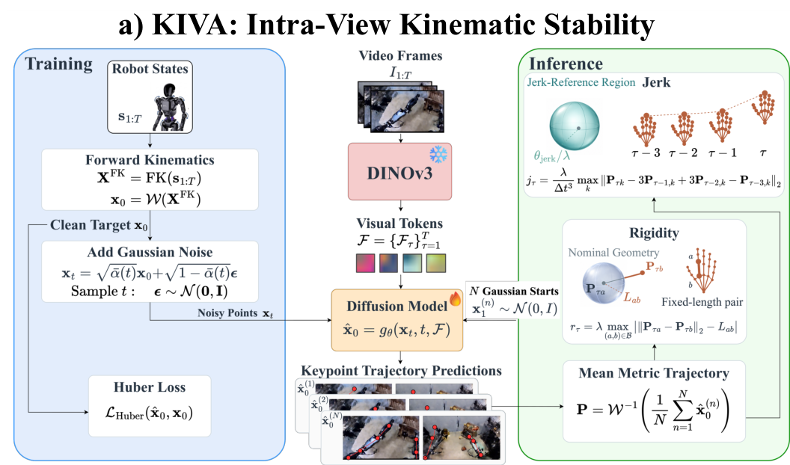

# KIVA: Kinematic Invariant Violation Assessment

**KIVA** is a reference-free metric for single-view generated robot videos. A keypoint reader
(frozen [DINOv3](https://huggingface.co/facebook/dinov3-vitl16-pretrain-lvd1689m) + diffusion
head) recovers 3-D robot keypoints from the frames, and KIVA checks link rigidity and joint
jerk against thresholds fitted on real teleop of the same robot.

Both scores are **lower is better**:

| Score | Meaning |
|---|---|
| Rigidity | % of 16-frame segments whose bone-length error is above the threshold |
| Jerk | % of 16-frame segments whose jerk is above the threshold |



**Figure.** DINOv3 tokens condition a diffusion head that predicts 3-D keypoints; rigidity
and jerk are scored on the averaged trajectory $\mathbf{P}$.

## Method

### Keypoint reader

1. Frozen DINOv3 encodes each frame $I_\tau$ into tokens $\mathcal{F}_\tau$.
2. A diffusion head $g_\theta(\mathbf{x}_t, t, \mathcal{F})$ is trained with a Huber loss to
   denoise keypoints $\mathbf{x}_0 = \mathcal{W}(\mathrm{FK}(\mathbf{s}_{1:T}))$ from the
   recorded robot state.
3. At inference, $N$ Gaussian starts are denoised and averaged:
   $\mathbf{P} = \mathcal{W}^{-1}\big(\tfrac{1}{N}\sum_n \hat{\mathbf{x}}_0^{(n)}\big)$.

### Detectors

$$r_\tau = \max_{(a,b)\in\mathcal{B}} \big|\, \lVert \mathbf{P}_{\tau a} - \mathbf{P}_{\tau b} \rVert_2 - L_{ab} \,\big|,
\qquad
j_\tau = \frac{1}{\Delta t^3} \max_k \lVert \mathbf{P}_{\tau k} - 3\mathbf{P}_{\tau-1,k} + 3\mathbf{P}_{\tau-2,k} - \mathbf{P}_{\tau-3,k} \rVert_2$$

$\mathcal{B}$ are the fixed-length bone pairs of the URDF with rest length $L_{ab}$. Per
16-frame segment, rigidity takes the median and jerk the maximum. A segment is flagged when
it exceeds the threshold: the 95th percentile of the same quantity on real clips of the robot
(the reader's validation split), fitted once and stored in [`thresholds/`](thresholds/).

## Data

Readers are trained on [`doanh25032004/vgp_datasets`](https://huggingface.co/datasets/doanh25032004/vgp_datasets)
(`{embodiment}/singleview/`). The validation split is also the calibration set.

| Reader | Robot | Corpus | Camera | fps | Train / val episodes |
|---|---|---|---|---|---|
| `a1x_ee.a1x_sv.sv1_4x3` | Galaxea A1X | RoboChallenge | `global` | 15 | 108 / 12 |
| `aloha_bimanual.bimanual_sv.sv1_16x9` | ALOHA | AIST Bimanual | `cam_high` | 30 | 271 / 29 |
| `fourier_gr1.humanoid_sv.sv1_16x9` | Fourier GR-1 | GR00T Teleop GR1 | `ego_view_freq20` | 20 | 234 / 26 |

Scored clips are `full_pred.mp4` in [`doanh25032004/video_gen_physics`](https://huggingface.co/datasets/doanh25032004/video_gen_physics);
the real anchor is the `full_gt.mp4` next to each one.

## Install

```bash
pip install -e "metrics/kiva[dino,video,bench]"   # Python 3.10, torch 2.7
```

`ffmpeg` must be on `PATH`. DINOv3 is gated: accept its license and run `hf auth login` once.

Download the URDF assets and the readers from [`twanghcmut/hallucinate-bench`](https://huggingface.co/buckets/twanghcmut/hallucinate-bench):

```bash
export KINESCORE_ASSETS=/path/to/assets
B=hf://buckets/twanghcmut/hallucinate-bench
hf sync $B/asset $KINESCORE_ASSETS
for R in a1x_ee.a1x_sv.sv1_4x3 aloha_bimanual.bimanual_sv.sv1_16x9 fourier_gr1.humanoid_sv.sv1_16x9; do
  hf buckets cp $B/train/$R/diffusion/checkpoint.pt ckpt/$R.pt
done
```

## General Usage

Each robot has a reader and a thresholds file, shipped in [`thresholds/`](thresholds/). Commands
run from the repo root, with the readers downloaded to `ckpt/`:

| Robot | `--model` | `--threshold` | rigidity | jerk | Clip size |
|---|---|---|---|---|---|
| Galaxea A1X (single arm) | `ckpt/a1x_ee.a1x_sv.sv1_4x3.pt` | `metrics/kiva/thresholds/a1x_ee.a1x_sv.sv1_4x3.json` | 8.38 mm | 354335 mm/s³ | 640×480 |
| ALOHA (bimanual) | `ckpt/aloha_bimanual.bimanual_sv.sv1_16x9.pt` | `metrics/kiva/thresholds/aloha_bimanual.bimanual_sv.sv1_16x9.json` | 55.49 mm | 3587158 mm/s³ | 768×432 |
| Fourier GR-1 (humanoid) | `ckpt/fourier_gr1.humanoid_sv.sv1_16x9.pt` | `metrics/kiva/thresholds/fourier_gr1.humanoid_sv.sv1_16x9.json` | 40.69 mm | 748616 mm/s³ | 768×432 |

```bash
kinescore score --model ckpt/a1x_ee.a1x_sv.sv1_4x3.pt \
  --threshold metrics/kiva/thresholds/a1x_ee.a1x_sv.sv1_4x3.json --videos /path/to/clips
```

or with the numbers given directly:

```bash
kinescore score --model ckpt/a1x_ee.a1x_sv.sv1_4x3.pt \
  --rigidity-threshold 8.38 --jerk-threshold 354335 --videos /path/to/clips
```

```
[score] 10 clips, 150 segments
[score] rigidity   21.3%   (32/150 segments > 8.38 mm)
[score] jerk       38.0%   (57/150 segments > 354335 mm/s^3)
```

`--videos` is searched recursively for `--pattern` (default `*.mp4`). Add `--out <dir>` to keep
`summary.json`, `metrics.csv` (per clip) and `segments.csv` (per segment).

### Calibrate

A new world model on one of these robots needs no calibration. A reader you train yourself
needs its thresholds fitted once, on real clips of its robot and view. The real validation
clips of the three readers are in the bucket (12, 29 and 26 clips), and the shipped
thresholds were fitted on them:

```bash
R=a1x_ee.a1x_sv.sv1_4x3
hf sync hf://buckets/twanghcmut/hallucinate-bench/train/$R/val real/$R
kinescore calibrate --model ckpt/my_reader.pt --real real/$R --out my_reader.json
```

```
[calibrate] rigidity          8.38 mm
[calibrate] jerk            354335 mm/s^3
[calibrate] wrote my_reader.json
```

Each threshold is the 95th percentile (`--percentile`) of the per-segment value over the real
clips. Then score with `--threshold my_reader.json`. Training a reader for a new robot:
[`docs/ADDING_A_ROBOT.md`](docs/ADDING_A_ROBOT.md).

### Integration wrapper

For the benchmark harness, [`metric.py`](metric.py) registers KIVA as `Hallucination`
(`name="kiva"`), wrapping [`run.sh`](run.sh) (sweeps over variants, real anchor with
`ROLE=gt`, aggregation with [`aggregate.py`](aggregate.py)). It reports `<det>_rate` per clip,
and with `score_ref=true` also `<det>_rate_excess`, the rate minus that of the paired real
clip. See
[`VENDORED.md`](VENDORED.md) for provenance of the vendored `kinescore` code.
