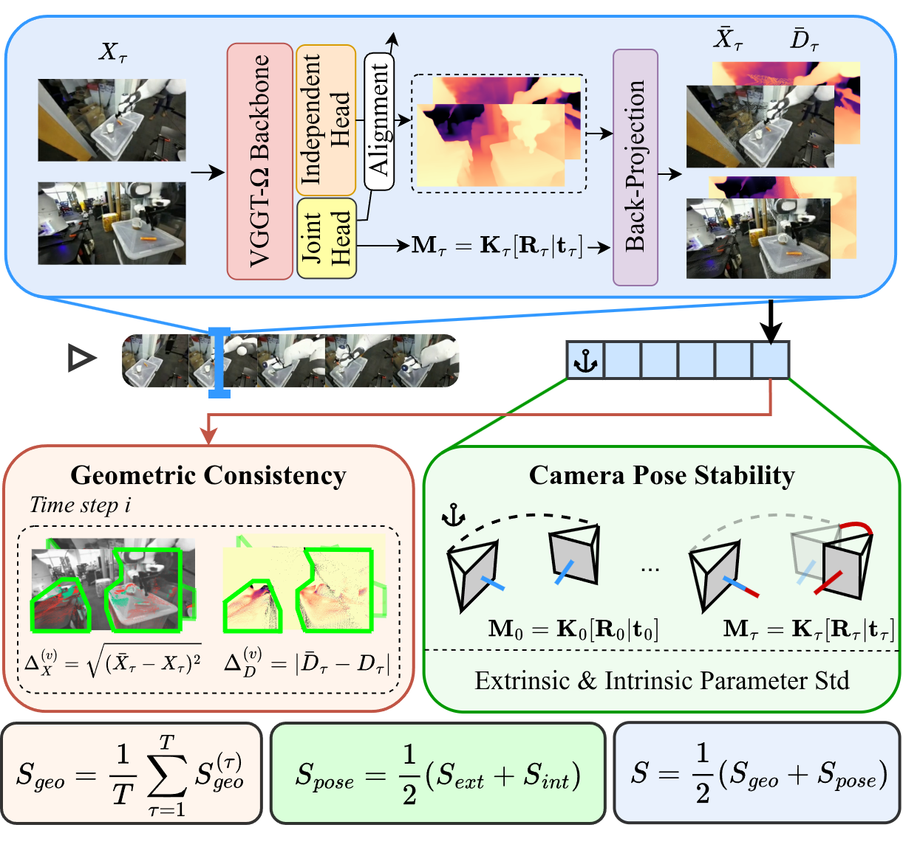

# RIGIS: Robotic Inter-view Geometry & Intrinsic-Extrinsic Stability

**RIGIS** is a *reference-free* metric for static-rig multi-view generated robot videos.
It asks whether synchronized cameras depict a **single coherent 3D scene** and whether estimated cameras remain **temporally stable**, using the feed-forward multi-view geometry model [VGGT-Ω](https://github.com/facebookresearch/vggt-omega) with a head modify for the depth estimation.

Both primary scores lie in \([0, 1]\) (**higher is better**):

| Score | Key | Meaning |
|---|---|---|
| Geometric consistency \(S_{\mathrm{geo}}\) | `geometric_consistency` | Cross-view depth/RGB agreement after lift–reproject |
| Camera pose stability \(S_{\mathrm{pose}}\) | `pose_stability` | Temporal stability of extrinsics + intrinsics |
| Final RIGIS Score | \(S=\tfrac{1}{2}(S_{\mathrm{geo}}+S_{\mathrm{pose}})\) | Mean of the two components |



**Figure.** Multi-view inputs are processed via VGGT-$\Omega$ to evaluate geometric consistency $S_{\mathrm{geo}}$ and camera pose stability $S_{\mathrm{pose}}$, yielding the unified metric $S$..

## Method

### Geometric consistency \(S_{\mathrm{geo}}\)

1. VGGT-Ω predicts per-view independent/joint depth and cameras.
2. Align independent depth to joint scale (median log-ratio on a center crop).
3. Unproject → shared 3D points → \(z\)-buffer reproject (RGB splat) under a bidirectional FOV covisibility mask.
4. On the covisible region, convert RGB RMSE \(\Delta_X\) and depth residual \(\Delta_D\) to bounded view scores, then
   \[
     S_{\mathrm{geo}}^{(\tau)}
       = \prod_{v}
         \tfrac{1}{2}\bigl(s_X^{(v)}+s_D^{(v)}\bigr),
     \qquad
     S_{\mathrm{geo}}
       = \tfrac{1}{T}\sum_{\tau} S_{\mathrm{geo}}^{(\tau)}.
   \]

### Camera pose stability \(S_{\mathrm{pose}}\)

Using frame \(0\) as anchor, measure temporal std of normalized intrinsics and of relative rotation/translation of the relocating camera, map to exponential scores, and set
\[
  S_{\mathrm{pose}} = \tfrac{1}{2}(S_{\mathrm{ext}}+S_{\mathrm{int}}).
\]

All quantities use **RGB only** (no ground-truth depth or cameras).

## Input format

An episode is a folder with one subfolder per view and frames `frame_XXXX.png` (or `.jpg`):

```text
/path/to/episode/
  view1/
    frame_0000.png
    frame_0001.png
    ...
  view2/
    frame_0000.png
    frame_0001.png
    ...
```

To build this layout from a mosaic / per-view mp4, use [`extract_frames.py`](extract_frames.py).

## Install

Download the **VGGT-Ω-1B-512** checkpoint via the official [VGGT-Ω repo](https://github.com/facebookresearch/vggt-omega) (Direct checkpoint link: [Hugging Face](https://huggingface.co/facebook/VGGT-Omega/blob/main/vggt_omega_1b_512.pt)).
`numba` is required by the geometric pipeline

## General Usage

Run commands from `metrics/rigis` so `python -m multiview_consistency.*` resolves.

### 1) Start the model service

```bash
python -m multiview_consistency.model_service \
  --host 127.0.0.1 \
  --port 6111 \
  --dtype float16 \
  --omega_checkpoint "/path/to/vggt_omega_1b_512.pt" \
  --omega_image_resolution 512 \
  --omega_patch_size 16
```

- `--compile` *(default)*: `torch.compile` on the aggregator (better steady-state latency for many episodes).
- `--no-compile`: eager mode (less first-run overhead; better for a single episode).

### 2) Score one episode or a folder of episodes

**One episode:**

```bash
python -m multiview_consistency.run_video_metrics \
  --episode_dir "/path/to/episode" \
  --views "view1,view2" \
  --host 127.0.0.1 \
  --port 6111
```

**Batch (each subdirectory is an episode):**

```bash
python -m multiview_consistency.run_video_metrics \
  --episodes_root "/path/to/folder" \
  --out_csv "/path/to/result.csv" \
  --views "view1,view2" \
  --host 127.0.0.1 \
  --port 6111
```

CSV columns include `geometric_consistency`, `pose_stability`, and `disjoint_frame_ratio`.

### Integration wrapper

For the benchmark harness, [`metric.py`](metric.py) registers RIGIS as `MultiviewConsistency` (`name="rigis"`), wrapping `run.sh` (checkpoint, service lifecycle, frame extraction). See [`VENDORED.md`](VENDORED.md) for provenance of the vendored VGGT-Ω / multiview code.
